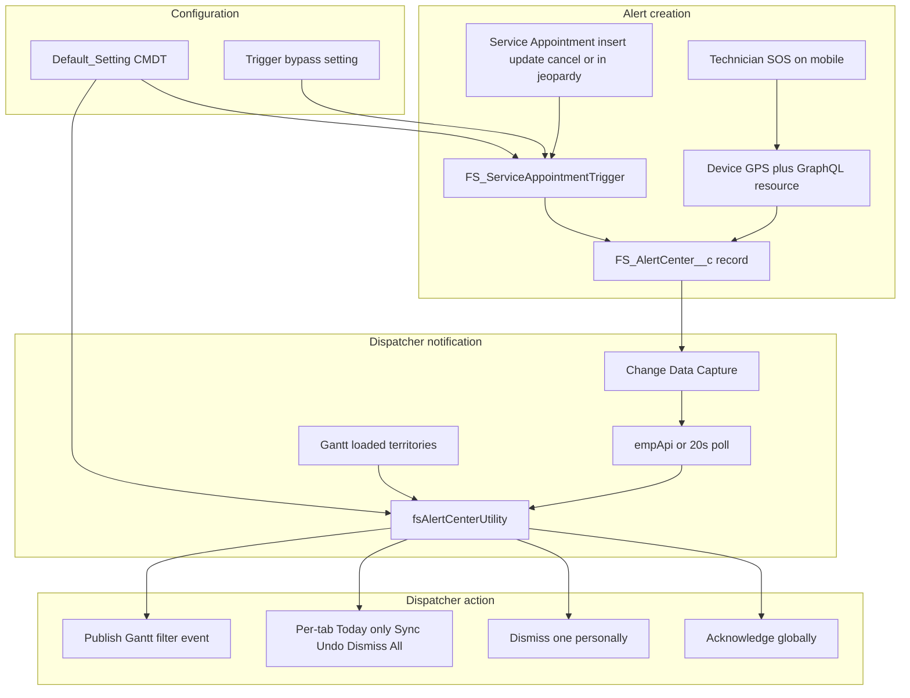
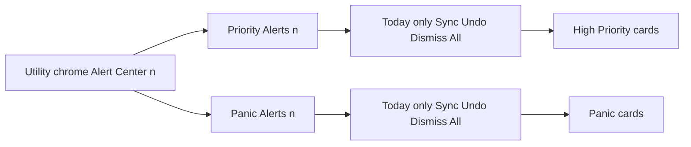
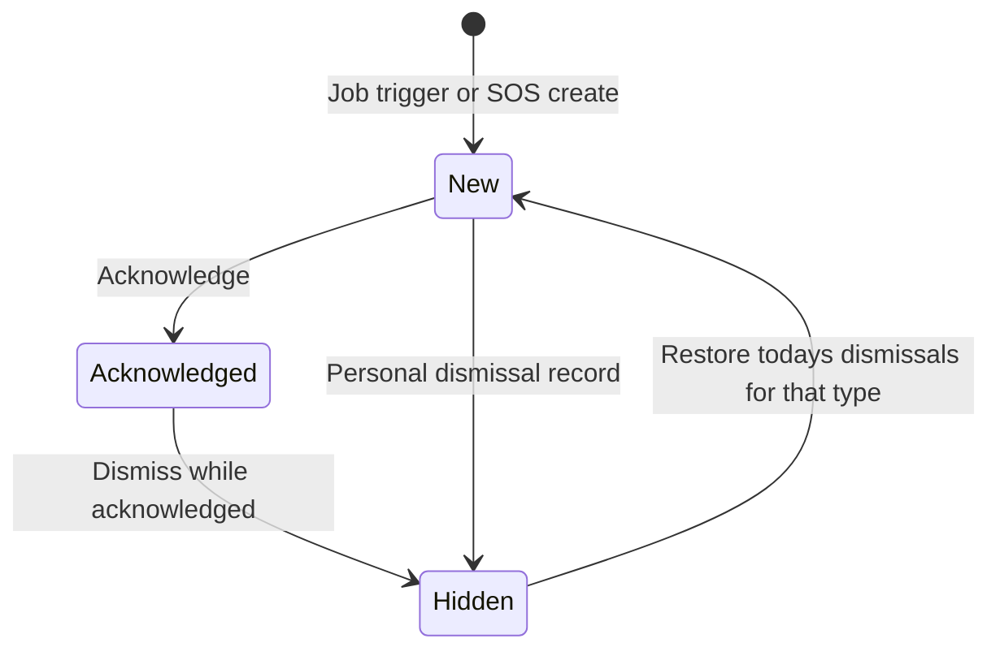

# Alert Center Component for Salesforce Field Service

A reusable Field Service package that alerts **dispatchers** of high-priority jobs, cancellations, in-jeopardy appointments, and field-resource panic events in the Service Territories they currently have loaded on the Gantt.

Dispatchers use the **FS Alert Center** utility bar LWC (`fsAlertCenterUtility`). Technicians raise panic events from the **FS Mobile Panic Button** global action (`fsMobilePanicButton`). Architecture, data model, per-tab action design, and sequence detail live in `docs/FS_Alert_Center_Design.md`. Manual steps to stand this up in a **new org** (permission sets, utility bar, publisher layout, CMDT, Offline Brief, and smoke tests) are in `README_IMPLEMENTATION.md`.

## Features

- Configurable **Priority**, **Panic**, **Cancellation**, and **In Jeopardy** alerts via Custom Metadata (no code change). New cancellation and jeopardy flags default **off**.
- High Priority Alerts created from the Service Appointment trigger when parent Work Order / Work Order Line Item priority matches a comma-separated list.
- Cancellation Alerts when a Field Services appointment status becomes `Canceled` **and** the running user has the Field Service Mobile permission set license. In Jeopardy Alerts when `FSL__InJeopardy__c` becomes true.
- Offline-capable Field Service Mobile SOS that creates a Panic Alert with GPS, Service Resource, optional Nature of the Emergency, and primary territory.
- Utility list filtered by the dispatcher’s **Gantt-loaded Service Territories**.
- Real-time updates via Change Data Capture and empApi (Lightning). Experience Cloud uses 20-second polling.
- Audio buzzer and utility-bar badge on new relevant alerts.
- Global **acknowledge** and personal **dismiss**, with **per-type** Dismiss All and restore of today’s dismissals.
- Tabs for each enabled type (**Priority**, **Cancellation**, **In Jeopardy**, **Panic**); each tab has **Today only** (default on), Sync, Undo, and Dismiss All (Salesforce utility chrome keeps the combined `Alert Center (n)` label).
- Job-card filter icon publishes a Field Service event that **creates and loads a temporary Gantt filter** for that Service Appointment.
- Packaged list views for All, High Priority, Panic, Cancellation, and In Jeopardy alerts.

## End-to-end flow



## Configurability

Edit Custom Metadata **FS Alert Center Setting** record **Default Setting** (`FS_Alert_Center_Setting.Default_Setting`).

| Field | Packaged default | What it controls |
|---|---|---|
| `Priority_Alerts_Enabled__c` | true | **On:** trigger may insert High Priority Alerts; utility shows Priority Alerts. **Off:** no job-alert inserts; Priority tab hidden. |
| `Panic_Alerts_Enabled__c` | true | **On:** utility shows Panic Alerts. **Off:** Panic tab hidden. Mobile SOS can still create records; they will not appear in the utility. |
| `Cancellation_Alerts_Enabled__c` | false | **On:** trigger inserts Cancellation Alerts when Status becomes `Canceled` **by a user with the Field Service Mobile permission set license**; utility shows Cancellation Alerts. |
| `Jeopardy_Alerts_Enabled__c` | false | **On:** trigger inserts In Jeopardy Alerts when `FSL__InJeopardy__c` becomes true; utility shows In Jeopardy Alerts. Distinct from the Work Order priority token `Jeopardy` in `Alert_Priorities__c`. |
| `Alert_Priorities__c` | `High,Critical,Jeopardy` | Comma-separated, case-insensitive list matched to Work Order Line Item Priority, then Work Order Priority. |

The utility renders **one tab per enabled type** (including a single tab when only one type is on). The Salesforce utility item label stays `Alert Center (n)` (combined count of enabled types). Each tab label carries **that type’s** count.

Turning Panic off in CMDT does **not** disable the mobile SOS button. It only hides Panic cards in the dispatcher utility.

## Criteria for alert creation

### High Priority Alert (Priority Alerts)

Handler: `FS_ServiceAppointmentTrigger` → `FS_ServiceAppointmentTriggerHandler` on after insert and after update.

All of the following must be true:

1. Hierarchy custom setting **FS Trigger Bypass Setting** → `Bypass_Service_Appointment_Trigger__c` is not true for the running user.
2. The Service Appointment record type is **Field Services** (`Field_Services`). Other record types skip lookup population and alert creation.
3. `Default_Setting` exists and `Priority_Alerts_Enabled__c` is true.
4. The Service Appointment is **inserted**, or `FS_Work_Order__c` / `FS_Work_Order_Line_Item__c` **changed** (parent lookups populated or re-parented). Changing only WO/WOLI priority without those lookup changes does not create a new alert.
5. No existing `FS_AlertCenter__c` with `Alert_Type__c = High Priority Alert` for that Service Appointment (one High Priority Alert per SA; other types can still be created).
6. Computed priority is not blank: **Work Order Line Item.Priority** if present, otherwise **Work Order.Priority**.
7. That value (trimmed, lowercased) is in `Alert_Priorities__c`.

Created record: `Alert_Type__c = High Priority Alert`, `Status__c = New`, Service Appointment, Service Territory from the appointment.

Before insert/update, the same trigger copies `ParentRecordId` onto `FS_Work_Order__c` and/or `FS_Work_Order_Line_Item__c` **only when that lookup is blank**. Existing values are not overwritten or cleared.

The job **card** shows `ServiceAppointment.Priority__c`. Creation uses **WO/WOLI Priority**. Keep those aligned in the org if you want the card to match the trigger.

### Cancellation Alert

Same trigger, after insert or after update, when `Cancellation_Alerts_Enabled__c` is true:

1. Bypass and Field Services record type checks as for High Priority.
2. Status is `Canceled` on insert, or Status **becomes** `Canceled` on update.
3. The running user has the **Field Service Mobile** permission set license (field resource). Cancellations by users without that license (for example dispatchers) do not create this alert.
4. No existing Cancellation Alert for that Service Appointment.

Created record: `Alert_Type__c = Cancellation Alert`. A High Priority Alert on the same appointment does not block this row.

### In Jeopardy Alert

Same trigger when `Jeopardy_Alerts_Enabled__c` is true:

1. Bypass and Field Services record type checks as for High Priority.
2. `FSL__InJeopardy__c` is true on insert, or **becomes** true on update.
3. No existing In Jeopardy Alert for that Service Appointment.

Created record: `Alert_Type__c = In Jeopardy Alert`. This uses the Field Service In Jeopardy checkbox, not Work Order priority `Jeopardy`.

### Panic Alert

Created only from `fsMobilePanicButton` with UI API `createRecord` (no Apex), so it can run **offline** after priming.

1. Optional **Nature of the Emergency** combobox (not required). Options come from the `Nature_of_the_Emergency__c` picklist via UI API (`getObjectInfo` and `getPicklistValues`). If object info or picklist values cannot be read (offline without priming, or a wire error), the combobox falls back to the packaged four values: Medical crisis, Physical assault, Threat of violence, Environmental accident. Priming `FS_AlertCenter__c` also loads those picklist values.
2. Device GPS (`navigator.geolocation`, high accuracy, 10 second timeout).
3. GraphQL: Service Resource whose `RelatedRecordId` is the current user.
4. GraphQL: Service Territory Members; first with Territory Type `P` or `Primary` **and a non-blank** `ServiceTerritoryId` is stored as `Service_Territory__c`. If GraphQL errors, or the lookup Id is blank (common when Service Territory OWD is Private and the user cannot see that record in UI API), territory is omitted and SOS still inserts.
5. Insert via UI API `createRecord` only (no Apex): `Alert_Type__c = Panic Alert`, `Status__c = New`, Panic Service Resource, latitude, longitude, optional territory and nature. Apex `insert as system` is not used here because SOS must work **offline**; Apex runs only on the server.

If the user has no Service Resource, SOS shows an error and does not insert.

A Panic Alert **without** `Service_Territory__c` is stored but **never shown** in the utility, because the utility always filters on Gantt territories.

Prime these objects in the Field Service Mobile Offline Brief:

- `FS_AlertCenter__c`
- `ServiceResource`
- `ServiceTerritoryMember`

`ServiceTerritory` is **not** primed by this package. It must already be in the Field Service Mobile briefcase from a separate build (see `README_IMPLEMENTATION.md`).

## Gantt Service Territory filtration

The utility does not have its own territory picker. It **inherits the territories the dispatcher has loaded on the Field Service Gantt**.

Apex reads `FSL__User_Setting_Territory__c` where `FSL__User_Setting__r.FSL__User__c` is the current user, then returns alerts with:

`Service_Territory__c IN` that Id set

If the dispatcher has loaded **no** territories, the utility shows **no** alerts.

Use the **Sync** (refresh) icon on any type toolbar after changing Gantt-loaded territories so the query picks up the new set.

Matching is exact on the alert’s territory. Parent/child territory trees are not expanded unless those territories are also loaded on the Gantt.

Additional visibility rules (on top of territory):

- Status is `New`, **or** Status is `Acknowledged` **and** the current user last modified the record (the acknowledger).
- The current user does not have an `FS_Alert_Dismissal__c` row for that alert.
- The alert type is enabled in CMDT.

## Utility layout and per-tab actions

The inner panel no longer has a duplicate **Alert Center (n)** header with shared Sync / Undo / Dismiss All. Salesforce utility chrome already shows `Alert Center (n)`. Experience Cloud (`isCommunityMode`) keeps only a minimize control so the floating panel can close.

Each enabled type has its own toolbar **above that type’s cards**:

| Control | Icon | Scope |
|---|---|---|
| **Today only** | checkbox | Default **checked**. Shows alerts whose `CreatedDate` is the dispatcher’s **local calendar day**. Uncheck to show all undismissed alerts of that type. Independent per tab. Hover text: uncheck shows all; check shows today’s. |
| **Sync** | refresh | Reloads **all** enabled types from Gantt territories (`loadAlerts`). Same query either tab; the icon is repeated so it is always next to the list you are looking at. |
| **Undo** | undo | Restores **today’s** personal dismissals for **that type only**. |
| **Dismiss All** | clear | Personally dismisses **New** cards **currently visible** on that type (respects Today only). Skips acknowledged cards. |

Tab labels (enabled types only):

- `Priority Alerts (n)` — High Priority Alert cards currently visible (after Today only)
- `Cancellation Alerts (n)` — Cancellation Alert cards currently visible (after Today only)
- `In Jeopardy Alerts (n)` — In Jeopardy Alert cards currently visible (after Today only)
- `Panic Alerts (n)` — Panic Alert cards currently visible (after Today only)

Empty copy: “No priority/panic/cancellation/in jeopardy alerts for today.” when that tab’s Today only is checked; otherwise the loaded-filters copy.

Internal tab values: `jobs`, `cancellation`, `jeopardy`, `panic`. Toolbar `data-alert-type`:

- Priority: `High Priority Alert`
- Cancellation: `Cancellation Alert`
- In Jeopardy: `In Jeopardy Alert`
- Panic: `Panic Alert`



### Why Dismiss All and Undo are per type

A shared header Dismiss All used whichever list `activeTab` pointed at. If the dispatcher stayed on Priority Alerts, Panic **Dismiss All** was never the header’s target even when they thought they were clearing panic. Undo deleted **all** of today’s `FS_Alert_Dismissal__c` rows for the user, so restoring Priority also restored Panic (and the reverse).

Implementation:

1. `handleDismissAll` reads `event.currentTarget.dataset.alertType` and dismisses only **New** cards from `jobAlerts` or `panicAlerts`.
2. `handleUndoDismissAll` calls `undoAllDismissals(alertType)`.
3. Apex deletes today’s dismissals for the current user where `AlertCenter__r.Alert_Type__c` equals that value. Blank or unknown types are ignored (no deletes).
4. `dismissAllAlerts(List<Id>)` is unchanged; the LWC only sends IDs for the chosen type.

Card-level Acknowledge and Dismiss are unchanged (one record at a time).

## Acknowledge, dismiss, and restore



| Action | Scope | Behavior |
|---|---|---|
| **Acknowledge** (check icon) | Global | Sets Status to `Acknowledged`. Other dispatchers lose the card (they are not LastModifiedBy). The acknowledger still sees it. |
| **Dismiss** one (close icon) on a **New** alert | Personal | Inserts `FS_Alert_Dismissal__c` for this user. Others still see the alert. |
| **Dismiss** one on an **Acknowledged** alert | Personal + global revert | Inserts `FS_Alert_Dismissal__c` for this user **and** sets Status back to `New`. The dismisser no longer sees the card. Other dispatchers in matching territories can see it again. |
| **Dismiss All** (clear icon on a type toolbar) | Personal, that type, visible list | Dismisses **New** cards currently shown on that type (Today only applies). Skips acknowledged cards. Does not touch the other type. |
| **Restore** (undo icon on a type toolbar) | Personal, that type | Deletes this user’s dismissal rows with `CreatedDate = TODAY` **and** `AlertCenter__r.Alert_Type__c` matching that toolbar. Older dismissals and the other type are not restored. |

## Dynamic Gantt filter from the job card

On a High Priority (Priority Alerts) card, the filter icon calls `FS_AlertCenterUtilityController.createTemporaryGanttFilter`.

That method publishes Field Service platform event `FSL__CreateFilterEvent__e`:

- Appointment Ids: JSON array with that Service Appointment Id
- Filter name: `{AppointmentNumber} - Priority Alert`
- Category: `GENERAL`
- Load immediately: true

The Gantt listens for the event, creates a **temporary filter**, and loads it so the board shows that appointment. Panic cards do not include this control.

## List views

Open the **FS Alert Centers** tab. Packaged list views (Everything scope — **not** Gantt-filtered):

| API name | Label | Filter | Typical use |
|---|---|---|---|
| `All` | All | none | Full columns including Nature and GPS |
| `FS_All_Alert_Centers` | FS All Alert Centers | none | Day-to-day list without Nature/GPS |
| `FS_All_High_Priority_Alerts` | All High Priority Alerts | Alert Type = High Priority Alert | Job alerts; Service Appointment column |
| `FS_All_Cancellation_Alerts` | All Cancellation Alerts | Alert Type = Cancellation Alert | Canceled appointments; Service Appointment column |
| `FS_All_In_Jeopardy_Alerts` | All In Jeopardy Alerts | Alert Type = In Jeopardy Alert | In Jeopardy appointments; Service Appointment column |
| `FS_All_Panic_Alerts` | All Panic Alerts | Alert Type = Panic Alert | Panic resource and Nature columns |

FS Alert Dismissals: `All` and `FS_All_Alert_Dismissals`.

Use the **utility** for live, territory-scoped work. Use **list views** for search and audit of records the user can access via sharing and the permission set.

## Dispatcher card contents

**Priority Alerts:** appointment number (opens the SA), Gantt filter, copy appointment number, SA Priority, Early Start, Due Date, Territory, Created, Address (Street and City).

**Cancellation Alerts:** appointment number, Gantt filter, copy, Status, Territory, Created, Address.

**In Jeopardy Alerts:** appointment number, Gantt filter, copy, In Jeopardy, Territory, Created, Address.

**Panic:** resource name (opens the Service Resource). Shown only when populated: Phone/Mobile, Employee Number, Nature of the Emergency. Always: Territory, Created. If GPS exists: **Reported Location** map pin.

## Real-time behaviour

- Lightning: subscribe to `/data/FS_AlertCenter__ChangeEvent`. CREATE reloads with toast and buzzer; UPDATE reloads silently.
- Experience Cloud / `isCommunityMode`: poll `getActiveAlerts` every 20 seconds.
- New job toast: warning, sticky. New panic or cancellation toast: error, sticky. New in-jeopardy toast: warning, sticky.
- Utility label: `Alert Center` or `Alert Center (n)`. New relevant alerts highlight the utility item and play `FS_AlertBuzzer`.

## Security and access

Assign one or more of these permission sets (no Salesforce license lock, so Experience Cloud booking users can be assigned the booking set):

| Permission set | API name | Assign to |
|---|---|---|
| FS Alert Center Appointment Booking | `FS_Alert_Center_Appointment_Booking` | External booking users. Field Services record type plus SA parent lookups, Status, Priority, In Jeopardy read, and Service Territory read (Operating Hours read is required by Salesforce for that). No Alert Center UI. |
| FS Alert Center Field Resource | `FS_Alert_Center_Field_Resource` | Technicians who raise panic from mobile. Alert Center create/read and panic field FLS; Service Resource, Service Territory Member, and Service Territory read (plus Operating Hours read). |
| FS Alert Center Dispatcher | `FS_Alert_Center_Dispatcher` | Schedulers and team leaders. Utility Apex, Alert Center read/edit, Dismissal create/read/edit/delete, tabs, SA display fields, Service Territory read (plus Operating Hours read). |

The panic **global action** still comes from assigning **FS Mobile Global Layout** to the Field Service Technician profile (not from a permission set).

Utility queries/DML and trigger SOQL run in system mode so booking users do not need Alert Center object access for SA save, and dispatchers see alerts in **loaded Gantt territories** without each alert being shared to them.

## Obtain the source (clone, copy, or retrieve)

Do **not** deploy from a Google Drive placeholder copy if files are online-only. Use a full local clone or an explicit retrieve.

### Clone from Git

From a machine with Git, in the parent folder where you want the project:

```bash
git clone <REMOTE_REPOSITORY>
cd job-alert-component
```

Replace `<REMOTE_REPOSITORY>` with your team’s Git remote (SSH or HTTPS). Confirm `sfdx-project.json`, `force-app/`, and `manifest/package.xml` are present.

If you already have a clone:

```bash
git pull
```

### Copy the project folder

Copy the entire repository directory, including:

- `sfdx-project.json`
- `force-app/`
- `manifest/package.xml`
- `docs/` (optional, documentation only)

Exclude `.sfdx/`, `.sf/`, and `node_modules/` if present. Those are local CLI state, not package source.

### Retrieve the metadata from an org that already has it

If the package is already in a source org and you need a local project:

```bash
sf project retrieve start --manifest manifest/package.xml --target-org <SOURCE_ORG_ALIAS>
```

That pulls every member listed in `manifest/package.xml` into `force-app/`.

## Deploy to an org

Prerequisites: Salesforce CLI, a DX project (`sfdx-project.json`), and an authorized org. Field Service (FSL) must already be in the target org (`FSL__User_Setting_Territory__c`, `FSL__CreateFilterEvent__e`).

Authorize (example):

```bash
sf org login web --alias <TARGET_ORG_ALIAS>
```

### Deploy the full package (recommended)

```bash
sf project deploy start --manifest manifest/package.xml --target-org <TARGET_ORG_ALIAS>
```

If the sandbox has **source tracking** and the CLI reports conflicts with org copies of the same components, overwrite the org with local source:

```bash
sf project deploy start --manifest manifest/package.xml --target-org <TARGET_ORG_ALIAS> --ignore-conflicts
```

### Deploy the default package directory

```bash
sf project deploy start --source-dir force-app --target-org <TARGET_ORG_ALIAS>
```

### Deploy one component

```bash
sf project deploy start --source-dir force-app/main/default/lwc/fsAlertCenterUtility --target-org <TARGET_ORG_ALIAS>
```

`manifest/package.xml` is the supported inventory for a complete install (Apex, LWCs, objects, CMDT, layouts including **FS Mobile Global Layout**, quick action, list views, tabs, flexipages, CDC member, static resource, permission sets).

The global publisher layout includes the panic action in **Mobile and Lightning Actions** (`platformActionList`). A Classic quick action list is also required for deploy (New Task, New Event, Log a Call). LWC actions cannot be placed in `quickActionList`.

## Post-deployment setup

The numbered new-org checklist (prerequisites through smoke test) is in `README_IMPLEMENTATION.md`. Summary:

1. Assign **FS Alert Center Dispatcher** to schedulers/team leaders, **FS Alert Center Field Resource** to technicians, and **FS Alert Center Appointment Booking** to external booking users. The booking set includes the Service Appointment **Field Services** record type.
2. Add **FS Alert Center** (`fsAlertCenterUtility`) to the Lightning app **utility bar**.
3. Confirm Change Data Capture includes `FS_AlertCenter__c` (packaged as `FS_ChangeEvents_AlertCenter_ChangeEvent` on the ChangeEvents channel).
4. Set **Default Setting** CMDT flags (Priority, Panic, Cancellation, Jeopardy) and priorities. Cancellation and Jeopardy default **off**.
5. Add **FS Mobile Panic Button** as a Field Service Mobile global action. The packaged publisher layout is **FS Mobile Global Layout**. In Setup → Publisher Layouts, assign it to the **Field Service Technician** profile (profile assignment is **not** in the package).
6. Prime `FS_AlertCenter__c`, `ServiceResource`, and `ServiceTerritoryMember` in the Field Service Mobile Offline Brief. Do **not** expect this package to prime `ServiceTerritory`; that object must already be in the briefcase from a separate Field Service build. After Service Territory OWD is Private, the three Alert Center permission sets include Service Territory **Read**, and sharing must still grant the inspector record access.
7. Ensure technicians have a **Service Resource** linked to their User and a **primary** Service Territory Member so panic rows get a territory and appear on dispatcher utilities.
8. Dispatchers must **load Gantt territories** or the utility stays empty.
9. On Field Service profiles (or equivalent permission set groups), assign the Service Appointment record type **Field Services** and set it as the **default** for users who create appointments from the Gantt or mobile. The permission set only makes the record type visible; it does not set the profile default. Existing appointments keep their current record type; they will not run this automation until updated to Field Services (no conversion job is packaged).

Optional: set **FS Trigger Bypass Setting** at org, profile, or user level to skip the Service Appointment trigger during data loads.

This package ships its own `FS_ServiceAppointmentTrigger`. It does **not** depend on a customer Trigger Actions Framework. If an org already uses TAF, do not also register `FS_ServiceAppointmentTriggerHandler` as a Trigger Action while this trigger is active, or the handler would run twice. To use TAF instead, empty the packaged trigger body in that org only and register the handler there.

## Packaged objects and automation (summary)

| API name | Type | Role |
|---|---|---|
| `FS_AlertCenter__c` | Custom object | Alert record (job or panic) |
| `FS_Alert_Dismissal__c` | Custom object | Per-user hide |
| `FS_Alert_Center_Setting__mdt` | Custom metadata | Feature flags and priorities |
| `FS_Trigger_Bypass_Setting__c` | Hierarchy custom setting | Skip SA trigger |
| `FS_ServiceAppointmentTrigger` | Trigger | Parent lookups (blank only) + High Priority, Cancellation, and In Jeopardy alerts for Field Services SAs |
| `ServiceAppointment.Field_Services` | Record type | Gates SA trigger automation |
| `fsAlertCenterUtility` | LWC | Dispatcher utility |
| `fsMobilePanicButton` | LWC | Technician SOS |
| `FS_Mobile_Panic_Button` | Global quick action | Hosts the SOS LWC |
| `FS_AlertBuzzer` | Static resource | New-alert audio |

Source API version in `sfdx-project.json` is **61.0**.
