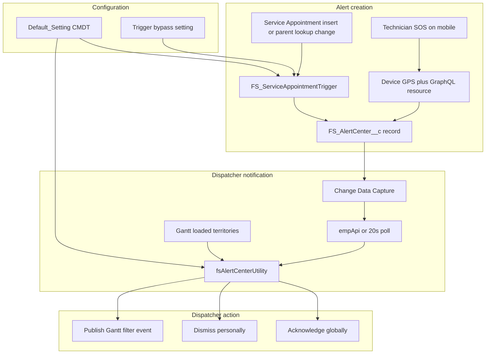
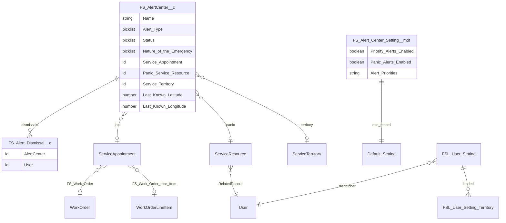
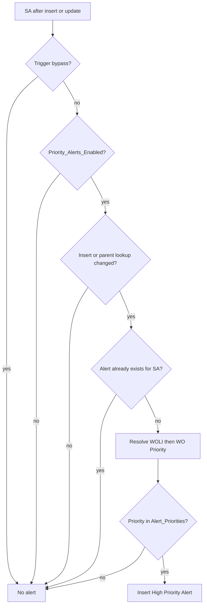
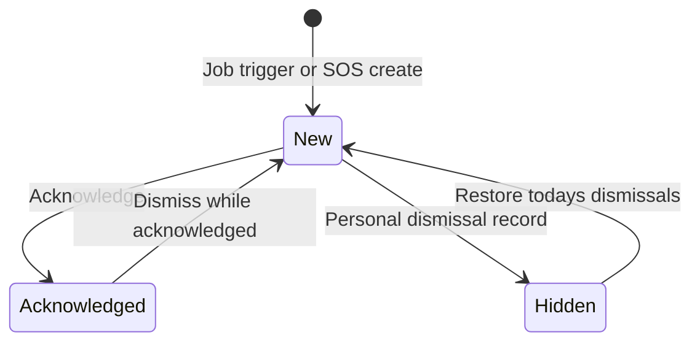

# FS Alert Center — Design Document

## 1. Purpose

FS Alert Center is a reusable Salesforce Field Service package that notifies **dispatchers** of two event types in the territories they currently have loaded on the Field Service Gantt:

- **High Priority Alert** — a Service Appointment whose parent Work Order or Work Order Line Item priority matches a configurable list.
- **Panic Alert** — a field technician SOS from Field Service Mobile, with GPS, optional emergency nature, and the technician’s Service Resource.

Dispatchers work from a Lightning Utility Bar component (`fsAlertCenterUtility`). Technicians raise panic alerts from a global mobile action (`fsMobilePanicButton`).

This document describes the data model, configuration, creation rules, dispatcher UX, Gantt integration, and deployment model. Operator steps (clone, deploy, post-setup) are also in `README.md`.

## 2. Actors and surfaces

| Actor | Surface | Role |
|---|---|---|
| Dispatcher / scheduler | Lightning App Builder utility bar (`fsAlertCenterUtility`) | See, acknowledge, dismiss, restore, and Gantt-filter alerts for loaded territories |
| Dispatcher (Experience Cloud, optional) | Same LWC with `isCommunityMode` | Same UX using 20-second polling instead of empApi |
| Field technician | Field Service Mobile global action (`fsMobilePanicButton`) | Optional nature picklist, then SOS create |
| Admin | Custom Metadata `FS_Alert_Center_Setting.Default_Setting` | Enable Jobs, Panic, or both; set priority values |
| Admin | Hierarchy custom setting `FS_Trigger_Bypass_Setting__c` | Bypass the Service Appointment trigger |
| Admin / auditor | FS Alert Center list views and tabs | Inspect all alerts outside the utility |

## 3. End-to-end flow



## 4. Data model



### 4.1 FS Alert Center (`FS_AlertCenter__c`)

Auto-number name format `AC-{0000000000}`.

| Field | Purpose |
|---|---|
| `Alert_Type__c` | `High Priority Alert` or `Panic Alert` (API name equals label) |
| `Status__c` | `New` or `Acknowledged` |
| `Service_Appointment__c` | Set for job alerts |
| `Panic_Service_Resource__c` | Set for panic alerts |
| `Service_Territory__c` | Territory used to match the dispatcher’s Gantt |
| `Nature_of_the_Emergency__c` | Optional panic classification |
| `Last_Known_Latitude__c` / `Last_Known_Longitude__c` | GPS from the mobile SOS |

Nature picklist values (optional, no default): `Medical crisis`, `Physical assault`, `Threat of violence`, `Environmental accident`.

### 4.2 FS Alert Dismissal (`FS_Alert_Dismissal__c`)

Personal hide record. Lookup `AlertCenter__c` to the alert; lookup `User__c` to the dispatcher. Sharing is controlled by parent. Auto-number `AD-{0000000000}`.

### 4.3 Configuration objects

- **Custom Metadata** `FS_Alert_Center_Setting__mdt`, packaged record `Default_Setting`.
- **Hierarchy custom setting** `FS_Trigger_Bypass_Setting__c.Bypass_Service_Appointment_Trigger__c`.

### 4.4 Service Appointment helper fields

The trigger copies `ParentRecordId` onto:

- `FS_Work_Order__c` when the parent is a Work Order
- `FS_Work_Order_Line_Item__c` (and then the parent Work Order) when the parent is a Work Order Line Item

Job alert creation reads **Work Order Line Item Priority**, then **Work Order Priority**. The job card displays `ServiceAppointment.Priority__c`.

## 5. Configurability — Jobs, Panic, or both

All display and job-creation switches live on **one** Custom Metadata record: `FS_Alert_Center_Setting.Default_Setting`.

| Field | Default | Effect |
|---|---|---|
| `Priority_Alerts_Enabled__c` | true | If false: trigger does **not** insert High Priority Alerts; utility hides the Jobs tab |
| `Panic_Alerts_Enabled__c` | true | If false: utility hides the Panic tab. SOS can still insert a Panic Alert record; dispatchers will not see it in the utility |
| `Alert_Priorities__c` | `High,Critical,Jeopardy` | Comma-separated, case-insensitive match against WOLI then WO Priority |

Utility tab layout:

| Priority enabled | Panic enabled | Utility UI |
|---|---|---|
| true | true | Tabset: **Jobs** and **Panic** |
| true | false | Jobs list only |
| false | true | Panic list only |
| false | false | Empty panel (no tabs, no cards) |

If only Panic is enabled, the active tab defaults to Panic. The utility badge count includes only enabled types.

Admins change flags in Setup by editing Custom Metadata **FS Alert Center Setting → Default Setting**. No code deploy is required to switch modes.

`Panic_Alerts_Enabled__c` is a **dispatcher UI gate**, not a mobile create gate, so a technician can still log an SOS when Panic is turned off in the utility.

## 6. Criteria for creating alerts

### 6.1 High Priority Alert

Runs on Service Appointment **after insert** and **after update**.

All of the following must be true:

1. Hierarchy setting `Bypass_Service_Appointment_Trigger__c` is not true for the running user/profile/org.
2. `Default_Setting` exists.
3. `Priority_Alerts_Enabled__c` is true.
4. The appointment is new, **or** `FS_Work_Order__c` / `FS_Work_Order_Line_Item__c` changed (parent lookups were populated or re-parented). A priority-only edit on the Work Order that does not change those lookups does **not** recreate an alert.
5. No `FS_AlertCenter__c` already exists for that Service Appointment (one job alert per SA).
6. Computed priority is not null: WOLI `Priority` if present, otherwise Work Order `Priority`.
7. That value, trimmed and lowercased, is in `Alert_Priorities__c`.

Insert payload: `Alert_Type__c = High Priority Alert`, `Status__c = New`, Service Appointment, Service Territory from `ServiceAppointment.ServiceTerritoryId`.



### 6.2 Panic Alert

Created only from `fsMobilePanicButton` via UI API `createRecord` (no Apex). Designed to work **offline** after Field Service Mobile primes:

- `FS_AlertCenter__c`
- `ServiceResource`
- `ServiceTerritoryMember`

SOS steps:

1. Technician may select Nature of the Emergency (optional combobox; four values hardcoded to match the field, so no extra UI API priming).
2. Device GPS via `navigator.geolocation` (high accuracy, 10 second timeout).
3. GraphQL: Service Resource where `RelatedRecordId` equals the running user (first match).
4. GraphQL: Service Territory Members for that resource; first member with Territory Type `P` or `Primary` becomes `Service_Territory__c`. If none, territory is omitted.
5. Create `FS_AlertCenter__c` with `Alert_Type__c = Panic Alert`, `Status__c = New`, `Panic_Service_Resource__c`, latitude/longitude, optional territory and nature.

If there is no Service Resource for the user, SOS fails with a toast and no record is created.

**Territory implication:** the utility only shows alerts whose `Service_Territory__c` is in the dispatcher’s loaded Gantt territories. A panic record with a blank territory never appears in the utility.

## 7. How the utility inherits Gantt Service Territory settings

Dispatchers choose which territories the Gantt loads. Field Service stores that as `FSL__User_Setting_Territory__c` rows under the user’s `FSL__User_Setting__c`.

`FS_AlertCenterUtilityController.getActiveGanttTerritories` queries:

```
FSL__User_Setting_Territory__c
WHERE FSL__User_Setting__r.FSL__User__c = current user
```

`getActiveAlerts` then requires:

- `Service_Territory__c IN` those territory IDs
- If the dispatcher has **no** loaded territories, the method returns an empty list (no alerts)

The utility **Refresh** control re-queries this set after the dispatcher changes Gantt-loaded territories. There is no separate territory picker in the utility; Gantt is the source of truth.

Matching is on the alert’s `Service_Territory__c`, not on child territories unless those children are also loaded on the Gantt.

## 8. What the dispatcher sees (and what they do not)

An alert is returned only when **all** of these are true:

1. Territory is in the dispatcher’s loaded Gantt territories.
2. Status is `New`, **or** Status is `Acknowledged` **and** `LastModifiedById` is the current user (the person who acknowledged it).
3. There is no `FS_Alert_Dismissal__c` for this alert and this user.
4. The alert type is enabled in CMDT (Jobs vs Panic tabs).

CDC (`/data/FS_AlertCenter__ChangeEvent` on the `ChangeEvents` channel) drives Lightning: CREATE reloads with toast and buzzer; UPDATE reloads silently. Experience Cloud uses 20-second polling because empApi is not used there.

New High Priority toasts are warning/sticky. New Panic toasts are error/sticky. The utility label shows `Alert Center (n)` and highlights when a new relevant alert arrives. Audio is static resource `FS_AlertBuzzer`.

### Job card

Appointment number (opens the SA), Gantt filter icon, copy SA number, `ServiceAppointment.Priority__c`, Early Start, Due Date, Territory, Created, Address (Street, City).

### Panic card

Resource name (opens the Service Resource). If populated: Phone/Mobile (`User.Phone`), Employee Number (`User.EmployeeNumber`), Nature of the Emergency. Always: Territory, Created. If GPS exists: **Reported Location** map pin.

## 9. Acknowledge and dismiss



### Acknowledge (global)

Sets `Status__c = Acknowledged`. Because visibility for acknowledged alerts requires `LastModifiedById = current user`, **other dispatchers lose the card immediately**. The acknowledger still sees it until they dismiss or someone else takes further DML.

### Dismiss one (personal, with a special case)

- If status is **New**: insert `FS_Alert_Dismissal__c` for the current user. Other dispatchers still see it.
- If status is **Acknowledged**: set status back to **New** (no dismissal row). That **returns the alert to everyone** in the matching territories. Dismiss is therefore “I’m done with this acknowledged item; put it back on the board if needed.”

### Dismiss all

Applies to the **currently visible list** (active Jobs or Panic tab, or the single list when only one type is enabled). Only **non-acknowledged** cards are dismissed. Acknowledged cards are left in place with an info toast if nothing else remains.

### Restore dismissed

Deletes the current user’s `FS_Alert_Dismissal__c` rows with `CreatedDate = TODAY`. Earlier days are not restored. After delete, `getActiveAlerts` shows those alerts again if they still meet territory and status rules.

## 10. Filter icon on the job card — dynamic Gantt filter

On a High Priority card, the filter icon calls `createTemporaryGanttFilter(saId, saNumber)`.

The controller publishes Field Service platform event `FSL__CreateFilterEvent__e`:

| Event field | Value |
|---|---|
| `FSL__ServiceApptIds__c` | JSON array of the one Service Appointment Id |
| `FSL__FilterName__c` | `{AppointmentNumber} - Priority Alert` |
| `FSL__Description__c` | Temporary filter for High Priority Alert |
| `FSL__FilterCategory__c` | `GENERAL` |
| `FSL__LoadFilterImmediately__c` | true |

The Gantt consumes the event and applies a temporary appointment filter so the dispatcher sees that SA on the board. Panic cards do **not** expose this control (there is no appointment to filter).

## 11. List views for inspecting alerts

Packaged on `FS_AlertCenter__c` (Everything scope):

| List view | Label | Filter | Notes |
|---|---|---|---|
| `All` | All | none | Includes Nature, SA, Panic Resource, lat/long |
| `FS_All_Alert_Centers` | FS All Alert Centers | none | Operational columns without Nature or GPS |
| `FS_All_High_Priority_Alerts` | All High Priority Alerts | Alert Type = High Priority Alert | Service Appointment column; no Nature |
| `FS_All_Panic_Alerts` | All Panic Alerts | Alert Type = Panic Alert | Panic Service Resource and Nature columns |

FS Alert Dismissal has `All` and `FS_All_Alert_Dismissals`.

List views are **not** Gantt-territory scoped. They show org data the user can access via sharing and the permission set. Use the utility for territory-scoped live work; use list views for audit and search.

## 12. Real-time, security, and runtime notes

- Alert queries and DML in the utility controller use `SYSTEM_MODE` / `as system` so dispatchers see alerts in loaded territories without each alert being shared to them. CMDT and some trigger SOQL use `WITH SECURITY_ENFORCED`.
- Permission set **FS Alert Center Component Access** grants object/FLS for Alert Center, Dismissal, Apex, tabs, Service Resource / STM read, Nature, User Phone and Employee Number read, and related SA fields.
- CDC member `FS_ChangeEvents_AlertCenter_ChangeEvent` selects `FS_AlertCenter__ChangeEvent` on channel `ChangeEvents`.
- Global publisher layout **FS Mobile Global Layout** puts `FS_Mobile_Panic_Button` in `platformActionList` (LWC actions cannot go in `quickActionList`). A Classic `quickActionList` (New Task, New Event, Log a Call) is required for deploy. Assign the layout to **Field Service Technician** in Setup; profile assignment is not packaged.
- If source tracking is on in the target sandbox, deploy with `--ignore-conflicts` when local package changes are the source of truth.

## 13. Component inventory

| Metadata | Name |
|---|---|
| LWC | `fsAlertCenterUtility`, `fsMobilePanicButton` |
| Apex | `FS_AlertCenterUtilityController`, `FS_AlertCenterUtilityControllerTest`, `FS_ServiceAppointmentTriggerHandler` |
| Trigger | `FS_ServiceAppointmentTrigger` |
| Quick Action | `FS_Mobile_Panic_Button` |
| Static resource | `FS_AlertBuzzer` |
| Flexipages | `FS_AlertCenter_Record_Page`, `FS_Alert_Dismissal_Record_Page` |

**Org prerequisites:** Field Service (FSL) including `FSL__User_Setting_Territory__c` and `FSL__CreateFilterEvent__e`; Service Appointment, Service Territory, Service Resource, Service Territory Member, Work Order, Work Order Line Item.

## 14. Known constraints

- One High Priority Alert per Service Appointment; later priority changes do not insert another row unless the parent lookups change and no row exists.
- Panic without a primary Service Territory Member is stored but hidden from the utility.
- Restore dismissed only covers **today’s** personal dismissals.
- Gantt filter applies to job cards only.
- Utility empty if the dispatcher has not loaded any Gantt territories.
- `Alert_Priorities__c` matches **WO/WOLI Priority**, not necessarily `ServiceAppointment.Priority__c` shown on the card.
